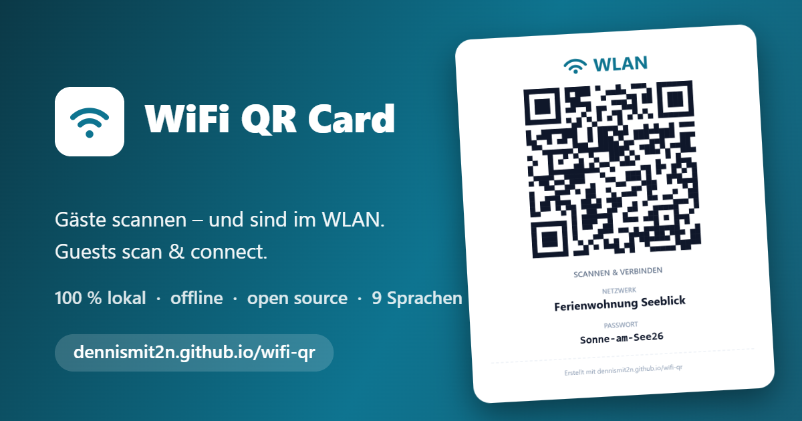
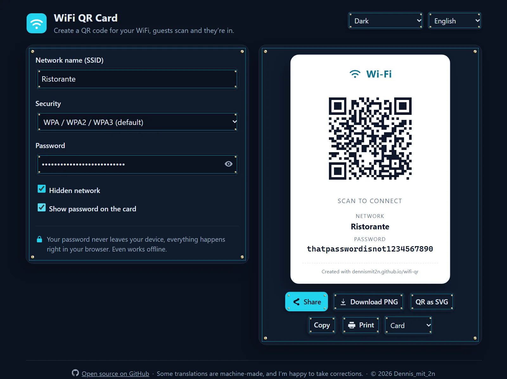

# WLAN-QR-Karte (WiFi QR Card)



**➡️ Ausprobieren: [dennismit2n.github.io/wifi-qr](https://dennismit2n.github.io/wifi-qr/)** &nbsp;·&nbsp; 🇬🇧 [English version](README.md)

Erstelle eine druckfertige WLAN-Karte mit QR-Code direkt im Browser. Gäste halten einfach die Handy-Kamera auf den Code, keine App, kein Passwort-Abtippen, und sind verbunden. Perfekt für den Kühlschrank, das Gästezimmer, die Ferienwohnung, das Café oder das Wartezimmer.



## Funktionen

- 📶 **Alle Netzwerktypen:** WPA / WPA2 / WPA3, WEP, offene und versteckte Netzwerke
- 🖨️ **Druckfertig:** gestaltetes Kärtchen und faltbarer Tischaufsteller, direkt aus dem Druckdialog
- 📤 **Teilen und Exportieren:** natives Teilen-Menü, PNG-Download, SVG für den Profi-Druck, Kopieren in die Zwischenablage
- 🌍 **14 Sprachen:** Deutsch, English, Español, Français, Italiano, Nederlands, Polski, Português, Türkçe, Русский, हिन्दी, 中文, 日本語, 한국어 (automatisch erkannt)
- 📱 **Installierbare PWA:** zum Startbildschirm hinzufügen; funktioniert nach dem ersten Besuch auch offline
- 🔒 **Radikal privat:** dein Passwort verlässt nie deinen Browser

## Datenschutz

Die ganze App besteht aus einer Handvoll statischer Dateien. Kein Server, kein CDN, keine Cookies, kein Konto. Der QR-Code entsteht lokal in deinem Browser: Schalte den Flugmodus ein, es funktioniert trotzdem. Du musst das nicht glauben: Öffne die DevTools und beobachte den Netzwerk-Tab, oder lies den Quellcode; er liegt komplett hier.

## Entwicklung

Kein Build-Schritt, keine Abhängigkeiten.

```bash
node tools/dev-server.js
```

Dann http://localhost:8613 öffnen. Ändern, neu laden, fertig.

**Beim Deploy:** die `CACHE`-Konstante in [sw.js](sw.js) hochzählen, damit installierte Clients die neue Version sofort bekommen. (Der Service Worker aktualisiert gecachte Dateien zusätzlich im Hintergrund, stale-while-revalidate, ein vergessener Bump heilt sich also beim nächsten Besuch von selbst.)

## Übersetzungen

Alle Oberflächen-Texte liegen in [js/i18n.js](js/i18n.js). Einige Übersetzungen sind maschinell erstellt. Wenn etwas in deiner Sprache seltsam klingt, nehme ich Korrekturen per Pull Request oder Issue gern an.

## Danksagung

- QR-Kodierung durch [qrcode-generator](https://github.com/kazuhikoarase/qrcode-generator) (MIT, © Kazuhiko Arase), lokal eingebunden in `js/vendor/`, damit die App ohne externe Requests auskommt.
- „QR Code“ ist eine eingetragene Marke von DENSO WAVE INCORPORATED.

## Lizenz

[MIT](LICENSE) für alles in diesem Repository. Der lokal eingebundene QR-Generator von Kazuhiko Arase trägt seine eigene MIT-Lizenz (oben genannt), im Kopf der Dateien angegeben.
